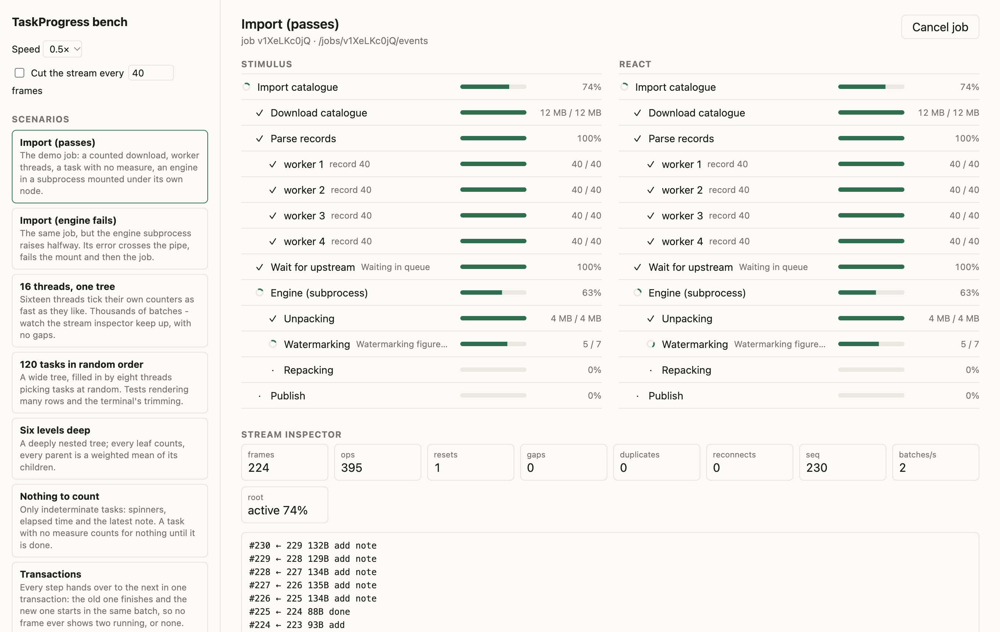

# TaskProgress

Progress for task trees: in one process, across threads, Fibers, Ractors and subprocesses, and out to a terminal or a browser.

Think progress bars, but properly, for complex task trees that the user needs to be updated on. Fit for both the web and the CLI.

The progress is not a mutable structure but an _event log_ which allows task progress collection to be distributed. Every change goes through one lock, which numbers it and commits it as a batch. Outputs receive the batches in order: a terminal renderer, a pipe, an SSE stream, a Sossego stream. A batch is one transaction. On a pipe it is one line, in a stream one event or row, so a reader gets all of it or none of it.

Any run of batches can be squashed into one, and a reader that joins late starts from that squash. This also lends itself perfectly to redraw-the-world UIs like React - but using it with Stimulus is a breeze as well.

<picture>
  <source media="(prefers-color-scheme: dark)" srcset="docs/bench-dark.png">
  
</picture>

The [MANUAL](MANUAL.md) has everything; this page has what you need first.

## Install

```ruby
gem "task_progress", github: "julik/task_progress"
```

Ruby 3.4 or newer. No runtime dependencies. Typed: RBS signatures ship in `sig/generated`, and the code is checked against them with Steep.

## A bar

```ruby
bar = TaskProgress.bar("Importing", total: rows.size)
rows.each { import(it) && bar.tick! }

TaskProgress.iterate(rows, "Importing") { |row| import(row) }  # or let it do the counting
```

```
⠹ Importing  ██████████░░░░░░░░░░ 21/40  19/s  ETA 1.0s  1.1s
```

It finishes at its total, and is finished for you when the program exits. `bar.puts("Skipped row 12")` prints a line above it that stays.

## A tree

```ruby
TaskProgress.cli("Import") do |root|
  download = root.subtask("Download", total: io.size, unit: "bytes")
  rows = root.subtask("Rows", total: rows.size, weight: 3, cancelable: true)

  download.run { copy(download.track_io(io)) }
  rows.run { rows.each { import(it) && rows.tick! } }
end
```

A block is a task's work: done when it returns, failed with the error when it raises. A parent reads 100% only once it and everything under it are done. On a terminal the tree redraws in place; piped or on CI it writes an execution log instead - one finished line per thing worth saying, never a redraw.

## In a web app

Stream any task - the whole tree, or one branch of it - as Server-Sent Events:

```ruby
# Rails
headers.merge!(TaskProgress::SSE::HEADERS)
self.response_body = TaskProgress::SSE.new(task)
```

and draw it with the browser client that ships in `js/` (`TaskProgress.js_path`): plain ES modules, no build step, with a Stimulus controller and a React component on top.

```html
<div data-controller="task-tree" data-task-tree-url-value="/jobs/42/progress"></div>
```

For a job that runs elsewhere, publish its batches to a stream (`PublishingOutput`, made for Sossego) and serve that. Work that runs in the browser itself can be grafted under a server task with `LocalTasks`.

## Across processes

```ruby
engine = root.mount("Engine", weight: 3)
engine.spawn(RbConfig.ruby, "engine.rb")  # engine.rb uses TaskProgress.cli, and reports up a pipe
```

The child's tree lands under the mount, and a cancel goes down to it the same way. Ractors work too, on Ruby 4.0.

## Canceling

```ruby
task.cancel!("Not needed")                     # from any thread
root.request_cancel(path, "From the browser")  # as a request: :canceled, :forwarded, :moot or :refused
```

Whoever works on a canceled task next gets a `TaskProgress::Canceled`, which `run` takes as the end of that work. Blocking work can use `on_cancel { }` to unblock. The renderers show a cancel button on tasks marked `cancelable: true`, and `TaskProgress::CancelToken` signs the right to press it.

## The bench

`bin/dev` starts a bench on http://localhost:9292: pick a scenario and watch it in both renderers side by side, with a stream inspector. Cancel tasks, cut the stream to watch it resume, or join a job late. The terminal demo is `ruby -Ilib examples/cli_demo.rb`.

## License

MIT
